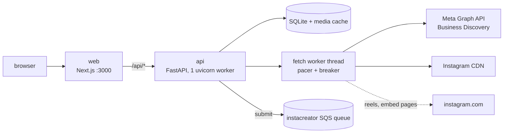

# 📸 instascraper

> Local, single-user tool for browsing public Instagram profiles and saving their media at full quality.

**A FastAPI and Next.js app that reads public Business and Creator accounts through Meta's Business Discovery API, with every Instagram-facing call funnelled through one paced worker thread so request serialization is structural, not a convention.**

<!-- readme-header -->
      

## What it does

- **Browse a profile.** Look up a username, see a contact-sheet grid of metadata and thumbnails, load more, and track accounts. Full-resolution media is fetched only when you select posts and press Download, then cached.
- **Download** selected posts into `OUT_DIR` as `base_01.jpg`, `base_02.mp4`; carousel slides get letter suffixes (`base_07a.jpg`). Reel video, which Business Discovery does not serve, comes from `yt-dlp` under a hard per-run cap.
- **Paste a post link** (`/direct`). The owner's handle is read from the public embed page, then the Graph API supplies the pictures.
- **Trending hashtags.** Ranks tags in your cached captions over the last 24 hours and 7 days by the summed likes, comments and views of the posts carrying them. Views exist only on reels, so reels weigh more.
- **Recreate queue.** Mark posts, prepare a payload (files on disk), and submit it to [instacreator](https://github.com/sathwikbairaboina2/instacreator)'s SQS queue. A status moves `selected`, `prepared`, `submitted`, and `submitted` is set only after the queue accepted the message. The handoff answers 503 when `SQS_ENDPOINT` is empty.
- **Self-protection.** A circuit breaker, pacing floors between Graph and CDN calls, a usage-limit stop, and a banner for rate limits, an invalid token or a missing token.
- **Fake adapter** (`IG_ADAPTER=fake`) for running the whole stack and the e2e suite with no network.

Limit worth knowing: Business Discovery sees **public Business and Creator accounts only**. Personal accounts are invisible to it; that is a property of the API.

## Architecture



`api` runs the HTTP loop plus exactly one fetch worker thread, and that thread is the only code that talks to Instagram. All Graph API usage is confined to `api/app/ig/`, and `api/app/ig/graph_map.py` is the one file that should need changes when Meta reshapes a response.

## Quickstart

```bash
cp .env.example .env      # fill in IG_GRAPH_TOKEN, IG_GRAPH_USER_ID, IG_GRAPH_VERSION, OUT_DIR
docker compose build
docker compose up -d      # open http://localhost:3000
```

### Getting the Graph credentials

One-time setup, none of it automatable:

1. Convert an Instagram account to Business or Creator.
2. Link it to a Facebook Page (Business Discovery is only available through the Facebook-Login flavour of the API).
3. Create a Meta developer app and add the Instagram product.
4. Grant the token `instagram_basic`, `pages_show_list`, `pages_read_engagement` and `business_management`.
5. Find your Instagram user id: `GET /me/accounts` for the Page id, then `GET /{page-id}?fields=instagram_business_account`.
6. Prefer a Business Manager system-user token (does not expire) over a long-lived user token (60 days).

Verify without starting the stack:

```bash
cd api && IG_GRAPH_TOKEN=... python -m pytest tests/test_live_canary.py -v
```

If grids go empty or errors turn odd, run the canary; a failure means `graph_map.py` needs updating. Re-record fixtures first with `cd api && python scripts/capture_graph_fixtures.py nike`.

### Tests and local development

```bash
cd api && python -m pytest        # backend, in-memory fake adapter, no network
bash scripts/e2e-native.sh        # full stack on the host, no Docker
bash scripts/e2e.sh               # same suite through Compose
```

For development without Docker: `python -m venv .venv`, `.venv/Scripts/python -m pip install -r api/requirements.txt`, `cd web && npm install`, then `scripts/e2e-native.sh` or start `uvicorn app.main:app --port 8000 --workers 1` (with `DB_PATH`, `MEDIA_DIR`, `OUT_DIR_CONTAINER`) and `API_ORIGIN=http://127.0.0.1:8000 npm run dev` in `web/`.

## Configuration

Names from `.env.example`, all documented there: `IG_GRAPH_TOKEN`, `IG_GRAPH_USER_ID`, `IG_GRAPH_VERSION` (required, never defaulted), `IG_GRAPH_REFRESH_PAGES`, `IG_GRAPH_USAGE_LIMIT`, `OUT_DIR`, `FIRST_PAGE_SIZE`, `PAGE_SIZE`, `IG_MIN_INTERVAL`, `IG_CDN_MIN_INTERVAL`, `IG_BACKOFF`, `IG_ADAPTER` (`graph` or `fake`). Compose also reads `SQS_ENDPOINT` (default: instacreator's ElasticMQ on host port 24104).

## Project layout

```
api/app/ig/        Graph adapter, fake adapter, reel downloader, embed-page reader
api/app/worker/    single fetch worker: queue, pacer, breaker, sweep
api/app/routes/    profiles, media, downloads, urls, hashtags, recreate, activity, health, status
api/app/services/  downloads, hashtags, quota, submit (SQS handoff), activity
web/app/           pages: profile (/p/<user>), /direct, /trending, /recreate, /activity
docs/              handbook, bug log, specs and plans in docs/superpowers/
CHANGELOG.md       what shipped and why
```

## Status

Personal tool, running locally; no CI workflow and no license file. `docs/bugs-2026-08-25.md` records the last soak findings. This README was checked against the code and file layout; the backend and e2e suites were not run for this revision.
